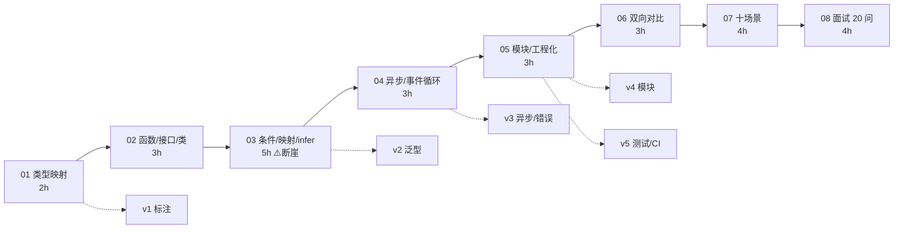

# 结构审查报告 · TypeScriptLearningByPython（Python 迁移版）

| 项 | 内容 |
|----|------|
| 审查对象 | `01-学习/TypeScriptLearningByPython/` 全部 21 篇 md |
| 角色 | 结构 / 技术 / 体验 三维合一（本报告为结构维度） |
| 日期 | 2026-11-14 |
| 文件覆盖 | **21/21 全读**（18 篇审查对象 + `reviews/` 3 篇历史报告仅作背景） |

---

## 一、完整性核验

| 文件 | 定位 | 体量 | 结构要素（前置/后置/frontmatter/自检） | 结论 |
|------|------|------|--------------------------------------|------|
| 00-总览索引 | 导航 | 11.9 KB | frontmatter 齐 / mermaid 路径图 / 角色导航 / 映射速查 / 检查点索引 / 项目索引 | ✅ 但无自检（合理） |
| README | 仓库入口 | 5.3 KB | 仅 `lark_doc_url` / 目录树 / 学时表 / 方法论对应 | ⚠️ 学时表与 00 不一致 |
| 01 环境与基础类型 | 第一周 ⭐ | 21.2 KB | 首段即"前置知识"（无独立链接段）/ 文末 ⬅️00 ➡️02、03 🔗06 / 自检 5 项 | ✅ |
| 02 函数与 OOP | 第一周 ⭐⭐ | 23.8 KB | ⬅️01 ➡️03 / 自检 5 项 | ✅ |
| 03 类型系统进阶 | 第一周 ⭐⭐⭐⭐ | 22.8 KB | ⬅️01、02 ➡️04、06 / 自检 6 项 | ⚠️ 难度断崖（S-1） |
| 04 异步与并发 | 第二周 ⭐⭐⭐ | 22.1 KB | ⬅️03 ➡️05 / 自检 6 项 | ✅ |
| 05 模块与工程化 | 第二周 ⭐⭐⭐ | 21.6 KB | ⬅️04 ➡️06、07 / 自检 5 项 | ✅ |
| 06 双向对比 | 第二周 ⭐⭐⭐ | 26.5 KB | ⬅️01-05 ➡️07、08 / 自检 5 项 | ⚠️ 与 02 重复（S-4） |
| 07 业务场景 | 第三周 ⭐⭐⭐⭐ | 23.1 KB | ⬅️06、05 ➡️08 / 自检 5 项 | ✅ 10 场景齐全 |
| 08 面试 20 问 | 第三周 ⭐⭐⭐⭐ | 21.1 KB | ⬅️07 / 自检 3 项 | ⚠️「前置知识」讲的是答题模板，不是先修依赖 |
| 99-第一周 | 检查点 | 8.2 KB | 知识图谱 / 练习×3 / 毕业自检 8 项 / 通过标准 / 下一步 | ✅ 结构最完整 |
| 99-第二周 | 检查点 | 9.7 KB | 同上（练习×3 / 自检 8 项） | ✅ |
| 99-第三周 | 检查点 | 13.5 KB | 同上 + 路径完成总结 | ⚠️ 终点定义冲突（S-5） |
| v1 类型标注 | 项目 | 7.3 KB | 目标 / 原始 Python / 三步任务 / 验收 / 参考实现 / 对比表 / 自检 4 项 | ✅ |
| v2 接口与泛型 | 项目 | 8.3 KB | 同上 + 工具类型表 | ✅ |
| v3 异步与错误 | 项目 | 11.1 KB | 同上 + Result 模式 | ⚠️ 验收与实现不对齐（S-3） |
| v4 模块与工程化 | 项目 | 13.2 KB | 同上 + 目录树 / tsconfig / package.json | ❌ 参考实现编译失败（技术 P0-2/3） |
| v5 测试与发布 | 项目 | 11.4 KB | 同上 + vitest / CI / 发布 | ❌ 测试导入错误（技术 P0-4） |

**完整性结论**：篇目数量与索引声明一致（8 核心 + 3 检查点 + 5 项目 = 16，加 00/README = 18）；06 的"12 + 15"两个数字与实际小节数**逐条数过，吻合**；08 的 Q1-Q20 **齐全无跳号**；07 的 10 个场景齐全。没有缺篇、没有空壳文件。

---

## 二、结构评分

**结构评分：7.5 / 10**（三维综合 6.8：结构 7.5 / 技术 6.0 / 体验 7.0）—— 骨架完整、顺序合理、检查点机制扎实；扣分集中在"难度曲线有一处断崖""学时口径三套数字""v1→v5 的接口演进未声明破坏性变更""02 与 06 大段重复"。

| 子维度 | 评分 | 说明 |
|--------|------|------|
| 完整性 | 9.0 | 无缺篇；索引/检查点/项目三段闭环 |
| 学习顺序（先用后讲） | 8.0 | 01 先环境后代码可接受；03 的位置有问题 |
| 难度递进 | 6.5 | ⭐→⭐⭐→⭐⭐⭐⭐ 的第三跳跨度过大 |
| 项目与正文对齐 | 7.0 | 五版概念对齐，但 v3 验收项没有对应实现、v4 破坏 v3 接口 |
| 交叉引用双向 | 8.5 | 主链完整，风格不统一（相对/绝对混用） |
| 重复冗余 | 6.5 | 02 §5 ≈ 06 §1-11 的缩略版；03 §4.1 ≈ 06 §9 |
| 学时分配 | 6.0 | 27h / 33h / 42h / 48h 四套数字并存 |

---

## 三、P1：结构缺陷（5 条）

### S-1 03 的难度断崖：⭐⭐ 直接跳到 ⭐⭐⭐⭐，且卡在第一周中段

- **位置**：`00` L29-L38（路径图）、L74（阶段表）；`03` 全文
- **原文**：`A2["02 函数与面向对象对比 ⭐⭐ 3h"] --> A3["03 类型系统进阶 TS 独有武器 ⭐⭐⭐⭐ 5h"]`
- **问题**：03 一上来就是条件类型、分布式条件类型、`infer`、映射类型、键名重映射、模板字面量类型、递归类型、类型体操 EventEmitter——这些是 TS 类型系统里最陡的一段（业界通常放在"进阶/高级"）。它的前置只声明 01/02，而 02 只讲到 interface/type/class；`keyof`、泛型约束、联合收窄的熟练度都不够。结果是第一周 10h 里有 5h 花在全路径最难的一篇上，且紧接在 ⭐⭐ 之后。
- **修复（三选一，建议 A）**：
  - A. 拆篇：`03A 泛型与 keyof（⭐⭐⭐ 2.5h）` + `03B 条件/映射/模板/infer/satisfies（⭐⭐⭐⭐ 3h）`，中间插一个 30 分钟小练。
  - B. 移到第二周开头（04 之前），第一周只留 01/02 + 一个"类型收窄小练"。
  - C. 保持位置但在 03 开头加 300 字"前置自测"（3 道 `keyof`/泛型约束小题），不达标先回 02。
- **验证**：结构推理（对比 00 的 ⭐ 定义与 03 小节清单）；无外部标准可引。**推理未验证**。

### S-2 学时口径四套数字并存，README 自身算术不成立

- **位置**：`00` L74-L78、L173；`README` L47-L54
- **原文**：00「第一周 3 篇 10h / 第二周 3 篇 9h / 第三周 2 篇 8h / 总学时约 27h」；README「第一周 3+1 复习 12h / 第二周 11h / 第三周 10h … **总学时：约 27h（核心笔记）+ 15h = 约 42h**」
- **问题**：README 的三周合计是 12+11+10 = **33h**（含 3 个检查点各 2h），但下一行仍写"核心笔记 27h"，33 ≠ 27；再加大项目 15h 应是 48h，却写 42h。00 的 27h 又不含检查点。四套数字（27 / 33 / 42 / 48）互不衔接，学习者无法规划时间。
- **修复**：统一为一张表并给出口径：
  | 组成 | 学时 |
  |------|------|
  | 8 篇正文 | 27h |
  | 3 个检查点 | 6h |
  | 毕业项目 v1-v5 | 15h |
  | **合计** | **48h** |
  00 与 README 都引用这张表（README 保留"42h 不含检查点"的口径亦可，但必须显式写清）。
- **验证**：逐项相加（10+9+8=27；12+11+10=33；33+15=48）。**实测（算术）**。

### S-3 v3 的验收标准要求"编译时穷尽性检查"，参考实现里没有任何穷尽性检查

- **位置**：`毕业项目/v3-异步与错误处理版.md` L152（验收）、L320-L344（参考实现）
- **原文**：验收「`Result<T, E>` 可辨识联合使用正确 ｜ 编译时穷尽性检查」；实现里只有 `if (result.ok) { ... } else { if (isValidationError(...)) ... }`
- **问题**：`Result` 只是两个分支的联合，`if (result.ok)` 天然覆盖两支，编译器不会因为你"漏处理某种 AppError"而报错——除非写 `switch` + `default: const _: never = err`。参考实现没有这一步，验收项无处落地，学员"通过验收"却学不到穷尽性检查（而这正是 03/06 反复强调的 TS 核心卖点）。
- **修复**：在参考实现里加一个 `formatError(err: AppError): string`，用 `never` 兜底：
  ```ts
  function assertNever(x: never): never { throw new Error(`unhandled: ${x}`); }
  function formatError(err: AppError): string {
    if (isTaskNotFoundError(err)) return `❌ Task ${err.taskId} not found`;
    if (isValidationError(err)) return `⚠️ ${err.field}: ${err.reason}`;
    return assertNever(err);   // 新增第三种错误类时，这里会编译报错
  }
  ```
  并在验收标准里写"新增第三种错误类时，`assertNever` 处必须编译报错"。同时把验收措辞从"编译时穷尽性检查"改成"用 `never` 兜底实现穷尽性检查"。
- **验证**：通读实现（无 `never`、无 `switch`）+ 编译实测（该实现本身可通过，说明"验收项"没有被检验）。**实测 + 推理**。

### S-4 02 §5 与 06 第一板块大面积重复（约 40%）

- **位置**：`02` L630-L643（"Python 有但 TS 没有的 OOP 特性"表）vs `06` L64-L445（12 个 Python-only 特性）
- **原文**：02 表列「多重继承 / 元类 / @classmethod / 猴子补丁 / __slots__ / with / __getattr__ / 描述符 / 无限制装饰器」；06 逐条展开同样 9 项 + kwargs、推导式、可变默认参数、反射、标准库
- **问题**：同一批概念在 02 出现一次（表格 + 每项一段代码）、在 06 又完整出现一次（表格 + Python/TS 双代码 + 迁移建议）。02 占 23.8KB，其中约 3KB 是 06 的预告；06 占 26.5KB。对读者是"读到第二遍"的疲劳，对维护是"改一处要改两处"（本轮技术报告里 06 的 3 个错误在 02 也有影子，正是重复维护的代价）。
- **修复**：02 §5 压缩为 5 行"速查表 + 一句 `→ 详见 [[06-Python有TS无与TS有Python无]]`"，把代码与迁移建议全部收敛到 06；同时把 02 的篇幅让给"this 绑定"和"interface vs type"（这两块才是 02 的独有价值）。
- **验证**：逐节比对（9 项重合 / 02 该章共 10 项）。**实测（文本比对）**。

### S-5 路径终点定义冲突：99-3 宣布"完成全部 8 篇"，但项目还有 5 篇 15h

- **位置**：`99-第三周复习检查点.md` L359-L374；`00` L163-L173
- **原文**：99-3「恭喜你完成了 TypeScript（Python 迁移版）学习路径的全部 8 篇核心笔记！」；00「毕业项目总学时：约 15h」
- **问题**：00 把 v1-v5 算进路径（27h + 15h），99-3 的"下一步"也指向 v1，但同页的"学习路径完成总结"已经用完成时宣告结束，还给出"下一步建议"（重写 Python 项目、读官方文档）。三处对"路径是否结束"给出三种信号，容易让人跳过项目。
- **修复**：把 99-3 L359 的标题改为「🎓 第三周完成总结（核心笔记 8/8）」，正文首句改为"你已完成 8 篇核心笔记（27h）。**路径还剩毕业项目 v1→v5（15h）**"；"下一步建议"里把"完成毕业项目"提到第一条并加链接。
- **验证**：文本对照三处。**实测**。

---

## 四、P2：结构改进（9 条）

| ID | 位置 | 问题 | 建议 |
|----|------|------|------|
| S-6 | 07 L104、08 L105、99-3 L18；对比 01-06 | 同一目录内链接风格混用：01-06 用 `[[02-函数与面向对象对比]]`，07/08/99 用 `[[01-学习/TypeScriptLearningByPython/07-...\|07-...]]`（全库绝对路径） | 统一为最短唯一路径；Obsidian 同目录短链即可。全库链接扫描未报断链，属风格问题 |
| S-7 | README L39-L42；00 L177-L185 | 两处写死了 `reviews/` 下的 3 个文件名（`01-结构审查报告.md` 等），而目录已含 2026-11-14 的三份新报告（本轮新增） | 改为目录级描述（`reviews/  # 三维审查报告（按日期存档）`），或在 00 的表里同时列最新一期与历史期次 |
| S-8 | 全部 18 篇 frontmatter | 字段不统一：01-08 有 `stage/order/difficulty/estimated_hours`；99-* 有 `stage/order` 但无 `project`；v1-v5 有 `project/version` 无 `stage`；README 只有 `lark_doc_url` | 定义最小字段集（title/created/tags/description/difficulty/estimated_hours），项目篇额外 `project/version`，README 补 title |
| S-9 | 00 L27-L46；07 L22-L41 | 07 的 mermaid 把场景 10 与 1 放在一组、场景 2 排在最后（S1,S10 / S3,S4,S5 / S6,S7,S8,S9,S2），与正文 1→10 顺序不符 | 按 1-10 顺序分三组（1-3 / 4-7 / 8-10），或在图里标注"按主题分组，非学习顺序" |
| S-10 | 00 L209 | 00 正文含"🔄 2026-09 口径"注记，但页脚仍写 `最后更新：2026-07-24` | 更新页脚为 2026-09 或注明"正文含 2026-09 补注" |
| S-11 | 05 L296-L305 | "级别 3：继承级别 2，再加……"只写在注释里，没有真正的 `extends` 示例 | 给一个 `tsconfig.base.json` + `tsconfig.lib.json` 的 `"extends": "./tsconfig.base.json"` 实例（正好呼应 05 自检里的"配置 extends 继承"挑战项） |
| S-12 | v5 L336-L354 | 最后一版只给 `package.json` 片段，缺完整成品清单（v4 反而给了完整版） | 在 v5 末尾补"最终 `package.json`（含 files/exports/scripts/publishConfig）"完整块，作为可发布的终点快照 |
| S-13 | v2 L232-L255 → v4 L147-L189 | v4 重写了 v2/v3 的 Repository 契约：`create(item: Omit<T,"id">): T` → `create(title: string, priority: Priority): Task`；`update(id, updates): T \| undefined` → `update(id, patch): Promise<T>`（缺失时改为 throw） | 在 v4 "改动清单"里显式列一条"⚠️ 破坏性变更：泛型 `Repository<T>` 收敛为 `TaskRepository`，`create/update` 签名与错误语义都变了"，并给一段"从 v3 迁移要改哪 3 处" |
| S-14 | 01 L562-L565、02 L748-L750 等 | 部分"🔗 关联"是单向的（01→06、02→06 有，06 的关联里没有回指 01/02 的具体小节） | 在 06 每个特性小节末尾加"详见 02 §4.7 / 03 §1.2"的回指，形成双向 |

---

## 五、学习顺序与概念依赖图（核验用）



**依赖核验**：泛型与 `keyof` 在 02 里**完全没有出现**（02 只讲到函数类型、interface/type、class、this），03 一开篇就同时引入 `<T>`、`extends` 约束、`keyof`、条件类型——这是断崖的根因；04 的 `Promise<T>` 依赖 03 的泛型 ✓；05 的 `.d.ts` 依赖 02 的 interface ✓；07 的 Zod `z.infer` 依赖 03 的 `infer` 概念 ✓（但 07 未回指 03）。**结论：主链成立，03 是唯一的"前置不足"点。**

---

## 六、毕业项目 ↔ 正文对齐矩阵

| 版本 | 声称对应 | 实际用到的正文知识 | 对齐结论 |
|------|----------|--------------------|----------|
| v1 | 01 基础类型、02 interface | 字面量联合（01）、interface（02）、可选参数默认值（02） | ✅ 对齐；但把 `created_at: str` 改成 `Date`，超出"只标注"约束（技术 P2-17） |
| v2 | 03 泛型 | `<T extends Identifiable>`、`Omit/Partial/Pick`、`keyof T` | ✅ 对齐；`sortBy` 的实现未处理 `T[K]` 不可比较的情况（编译能过，语义上对 Date/对象排序会错） |
| v3 | 04 异步 + 错误处理 | `async/await`、`Promise<T>`、自定义 Error、`Result` | ⚠️ 部分对齐：验收要穷尽性检查，实现没有（S-3） |
| v4 | 05 模块/tsconfig/构建 | ESM + `.js` 扩展、NodeNext、isolatedModules、declaration | ✅ 概念对齐；但参考实现编译失败（技术 P0-2/3），且破坏 v3 接口（S-13） |
| v5 | 05 测试/CI | vitest、coverage、GitHub Actions、npm publish | ✅ 概念对齐；测试导入错误（技术 P0-4），CI matrix 与正文数字不一致（技术 P1-10） |

**缺口**：正文里"类型体操"（03 §8）与"Stream/Async Iterator"（04 §7）、"Drizzle/Prisma"（07 场景 8）在毕业项目中完全没有落点。不要求全覆盖，但 03 §8 是 ⭐⭐⭐⭐ 篇的压轴，建议 v5 加一个"用 `DeepReadonly` 约束配置对象"的小任务，形成闭环。

---

## 七、重复冗余量化

| 重复对 | 重叠内容 | 估计重复量 | 建议 |
|--------|----------|-----------|------|
| 02 §5 ↔ 06 第一板块 | 9 项 Python-only OOP 特性 | ≈ 3.0 KB / 02 的 13% | 02 压成速查表 + 跳转（S-4） |
| 03 §4.1 ↔ 06 §9 | 内置工具类型表（Partial/Pick/Omit/Record/NonNullable/ReturnType） | ≈ 1.2 KB | 06 只留"Python 无对应"的结论，表格留 03 |
| 01 §5 ↔ 06 §11 | `as const` 替代 enum | ≈ 0.8 KB | 06 改为一句回指 |
| 04 §5.2 ↔ 08 Q8 | GIL vs 单线程表 | ≈ 0.6 KB | 保留（面试复述是刻意重复），但在 08 标注"复述 04 §5.2" |
| 05 §5.1 ↔ v5 对比表 | pytest→vitest 映射 | ≈ 0.8 KB | 保留（项目内自洽需要） |

合计可压缩 ≈ 5.6 KB（约全库 2%），收益主要是**降低"改一处漏一处"的维护风险**，篇幅其次。

---

## 八、已验证 vs 未验证

**已验证**

1. 18 篇审查对象逐篇通读（含 00/README），frontmatter、章节、自检、链接段逐项核对。
2. 06 的"12 + 15"小节数、08 的 Q1-Q20、07 的 10 场景：逐条计数吻合。
3. 学时四套数字的算术核验（27 / 33 / 42 / 48）。
4. 交叉引用双向性：逐篇记录 ⬅️/➡️/🔗，主链无断点（链接可达性已由全库扫描保证）。
5. 重复段落按小节比对（9/10 项重合）。

**未验证 / 保留意见**

1. "03 难度断崖"是主观判断，无外部基准；已给出三种可选修法，不强制拆篇。
2. 学时估算的"实际耗时"未做读者实测，只核对数字自洽性。
3. 未评估 08 的 20 问是否覆盖真实面试题库（缺外部样本）。
4. 历史报告 `reviews/01-结构审查报告.md` 的结论未逐条复核（只读背景），仅在新报告中覆盖其未发现项。

---

## 九、最优先修复（结构维度）

1. **统一学时表**（20 分钟）：00 与 README 引用同一张"27h 正文 + 6h 检查点 + 15h 项目 = 48h"表，消除 33/42/48 三套数字。
2. **给 03 加"前置自测 + 拆分建议"**（40 分钟）：哪怕不拆篇，也要在开头加 3 道 `keyof`/泛型约束小题，答不出先回 02。
3. **修 v3 的验收-实现缺口**（30 分钟）：补 `assertNever` 穷尽性示例，验收标准同步改口径。
4. **02 §5 收敛为速查表**（20 分钟）：去掉与 06 重复的 3KB，换成跳转链接。
5. **v4 补"破坏性变更"说明**（15 分钟）：列出 v3→v4 需要改的 3 处调用，避免学员按旧签名写代码。

---

*审查完成：2026-11-14*
