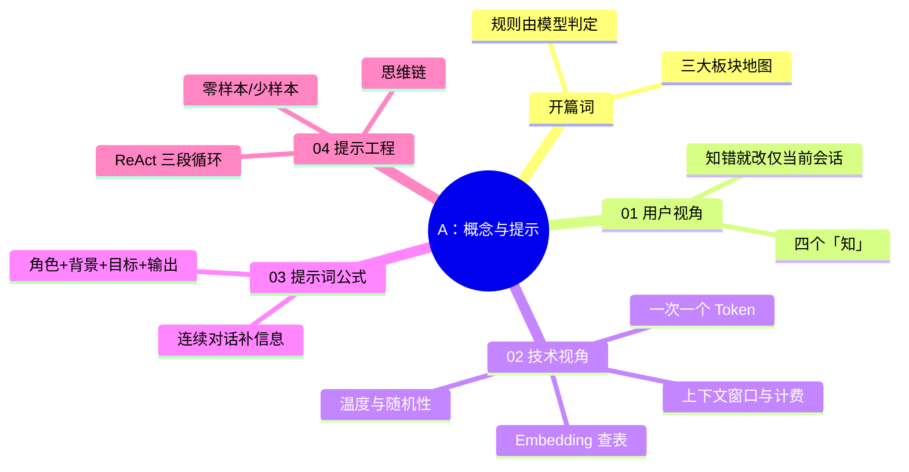

> 📌 覆盖 [[01-学习/程序员的AI开发第一课/开篇词｜普通程序员如何迈进AI时代？|开篇词]] 与 01–04。通过标准：🟢 全过 → 进阶段 B；🟡 有未过 → 回看对应篇自检；🔴 未过 → 重做 03/04 的练习并写 200 字卡点记录。

## 阶段 A 知识图谱

## 自测清单

- [ ] 能说出 AI 应用开发与传统开发的核心差异（部分规则由模型判定）
- [ ] 能复述四个「知」，并解释「知错就改」为什么不跨会话生效
- [ ] 能讲清「一次添加一个 Token」如何推出上下文窗口 / 按 Token 计费 / 流式三件事
- [ ] 能解释温度参数的作用方向（越小越确定）
- [ ] 能按公式写出四要素齐全的提示词，并完成一次「效果不佳→按公式重写→对比」的迭代
- [ ] 能各写一条零样本 / 少样本 / 思维链提示词并说出适用场景
- [ ] 能画出 ReAct 的 Thought / Action / Observation 循环，指出「行动」由谁执行

## 综合练习：给业务需求写提示词

选一个你真实工作中的任务（如写周报、生成 SQL、整理会议纪要），完成：

1. 按公式写出第一版提示词，记录输出；
2. 找出至少一处信息缺口，用连续对话补全，记录第二版输出；
3. 若任务含推理（如数字计算），加一版思维链提示词对比正确率；
4. 写 100 字复盘：哪一要素对效果影响最大。

## 自测选择题（5 题）

**1. 大模型「知错就改」的生效范围是？**
- A. 永久生效，模型权重会更新
- B. 仅当前会话（纠错信息进上下文，权重不变）✅
- C. 同一账号的所有会话
- D. 需要重新训练

**2. 上下文窗口限制的单位是？**
- A. 字符数
- B. 单词数
- C. Token 数 ✅
- D. 句子数

**3. temperature 设为 0 的效果是？**
- A. 输出随机性最强
- B. 输出确定性最强 ✅
- C. 生成速度最快
- D. 不产生费用

**4. 提示词公式的四要素是？**
- A. 角色 + 背景 + 目标 + 输出要求 ✅
- B. 角色 + 温度 + Token + 格式
- C. 问题 + 答案 + 示例 + 评分
- D. 系统 + 用户 + 助理 + 工具

**5. ReAct 循环中「Action」的执行者是？**
- A. 大模型自己
- B. 本地代码/工具 ✅
- C. 用户手动
- D. OpenAI 服务器

## 分级反馈表

| 你的情况 | 建议 |
|----------|------|
| 🟢 清单全过 + 选择题全对 + 练习完成 | ✅ 进入阶段 B（[[01-学习/程序员的AI开发第一课/99-阶段B检查点-API与框架|99-阶段B检查点]]） |
| 选择题错 1–2 题 | 回看错题对应篇的「🎯 本文学完自检」与勘误块 |
| 选择题错 3+ 题 | 重读 02/04，重做综合练习 |
| 综合练习做不动 | 从 [[01-学习/程序员的AI开发第一课/03｜提示词：怎样与大模型沟通？|03 提示词公式]] 重新开始 |

## 相关笔记

- ⬅️ 本阶段：开篇词 + 01–04
- ➡️ 下一阶段：[[01-学习/程序员的AI开发第一课/99-阶段B检查点-API与框架|99-阶段B检查点-API与框架]]
- 🔗 总览：[[01-学习/程序员的AI开发第一课/总览索引|总览索引]]

---
*创建：2026-11-13 · 课程化批（P1-11）*