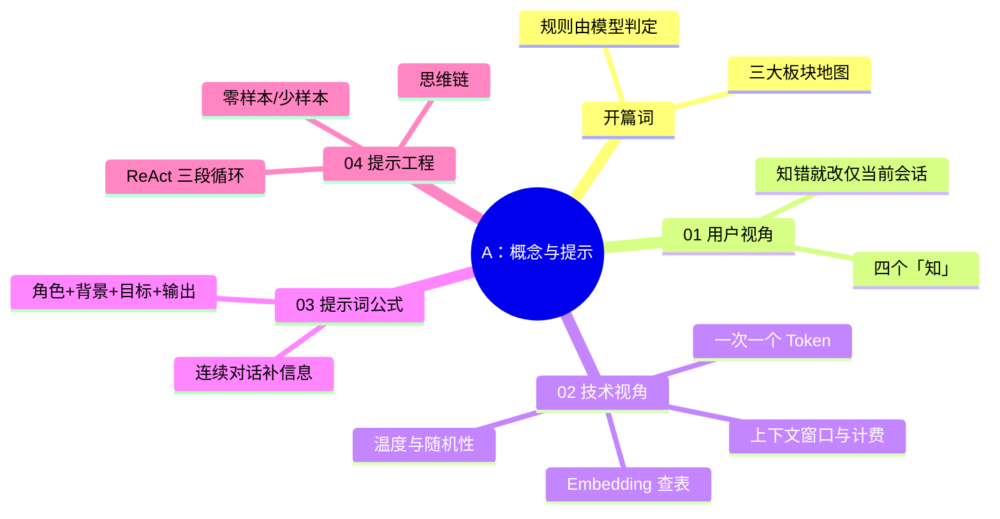

> 📌 覆盖 [[01-学习/程序员的AI开发第一课/开篇词｜普通程序员如何迈进AI时代？|开篇词]] 与 01–04。通过标准：✅ 全过 → 进阶段 B；⚠️ 有未过 → 回看对应篇自检；❌ 严重卡点 → 重做 03/04 的练习并写 200 字卡点记录。
> ⚠️ 环境前提：网页版大模型（或任一可用 API）即可，本阶段不要求配 SDK（05 篇才教）。

## 阶段 A 知识图谱

## 自测清单

- [ ] 能说出 AI 应用开发与传统开发的核心差异（部分规则由模型判定）
- [ ] 能复述四个「知」，并解释「知错就改」为什么不跨会话生效
- [ ] 能讲清「一次添加一个 Token」如何推出上下文窗口 / 按 Token 计费两件事（流式应答在阶段 B 的 06 篇验收）
- [ ] 能解释温度参数的作用方向（越小越确定）
- [ ] 能按公式写出四要素齐全的提示词，并完成一次「效果不佳→按公式重写→对比」的迭代
- [ ] 能各写一条零样本 / 少样本 / 思维链提示词并说出适用场景
- [ ] 能画出 ReAct 的 Thought / Action / Observation 循环，指出「行动」由谁执行

## 综合练习：给业务需求写提示词

选一个你真实工作中的任务（如写周报、生成 SQL、整理会议纪要），完成：

1. 按公式写出第一版提示词，记录输出；
2. 找出至少一处信息缺口，用连续对话补全，记录第二版输出；
3. 若任务含推理（如数字计算），加一版思维链提示词对比正确率；
4. 写 100 字复盘：哪一要素对效果影响最大。

**怎样算过**：两版输出可对比，且复盘能指认到具体要素（如「补了背景信息后不再答非所问」）；含推理的任务思维链版正确率不低于标准版（若两版全对，记录「该模型已内置推理，提示增益不明显」也算过）。

## 自测选择题（5 题）

**1. 大模型「知错就改」的生效范围是？**
- A. 永久生效，模型权重会更新
- B. 仅当前会话（纠错信息进上下文，权重不变）
- C. 同一账号的所有会话
- D. 需要重新训练

答案与解析

**答案：B**。纠错信息只是进入当前会话的上下文，权重不更新；新开会话即失效（01 篇勘误块）。

**2. AI 应用开发与传统开发的核心差异是？**
- A. 必须用 Python 而不能用其它语言
- B. 部分业务规则交给模型判定，而非全部由代码硬编码
- C. 不再需要测试与验收
- D. 界面必须是聊天框

答案与解析

**答案：B**。开篇词/01 篇：传统开发的规则全部硬编码；AI 应用把一部分判定（意图理解、内容生成）交给模型，因此要为不确定性设计验收与兜底——测试反而更重要。

**3. 「按公司自定义规则给文本打标签」最适合哪种提示技术？**
- A. 零样本——模型无所不知
- B. 少样本——给几个「输入→输出」示例让模型学会自定义规则
- C. 思维链——所有任务都该慢下来
- D. ReAct——打标签需要调用工具

答案与解析

**答案：B**。04 篇：通用任务零样本即可；自定义/领域规则模型事先不知道，给例子最有效；思维链针对推理题，ReAct 针对需要外部动作的任务。

**4. 提示词公式的四要素是？**
- A. 角色 + 背景 + 目标 + 输出要求
- B. 角色 + 温度 + Token + 格式
- C. 问题 + 答案 + 示例 + 评分
- D. 系统 + 用户 + 助理 + 工具

答案与解析

**答案：A**。03 篇公式：提示词 = 定义角色 + 背景信息 + 任务目标 + 输出要求。

**5. ReAct 循环中「Action」的执行者是？**
- A. 大模型自己
- B. 本地代码/工具
- C. 用户手动
- D. OpenAI 服务器

答案与解析

**答案：B**。模型只输出「要做什么动作」，真正执行的是本地代码（04 篇；13 篇的 PAUSE 就是控制权交接点）。

## 分级反馈表

| 你的情况 | 建议 |
|----------|------|
| ✅ 清单全过 + 选择题全对 + 练习完成 | ✅ 进入阶段 B（[[01-学习/程序员的AI开发第一课/99-阶段B检查点-API与框架|99-阶段B检查点]]） |
| 选择题错 1–2 题 | 回看错题对应篇的「🎯 本文学完自检」与勘误块 |
| 选择题错 3+ 题 | 重读 02/04，重做综合练习 |
| 综合练习做不动 | 从 [[01-学习/程序员的AI开发第一课/03｜提示词：怎样与大模型沟通？|03 提示词公式]] 重新开始 |

## 相关笔记

- 🎯 本阶段：开篇词 + 01–04
- ➡️ 下一阶段：[[01-学习/程序员的AI开发第一课/99-阶段B检查点-API与框架|99-阶段B检查点-API与框架]]
- 🔗 概念对照：[[01-学习/程序员的AI开发第一课/99-概念对照总表|99-概念对照总表]]
- 🔗 总览：[[01-学习/程序员的AI开发第一课/总览索引|总览索引]]

---
*创建：2026-11-13 · 课程化批（P1-11）*