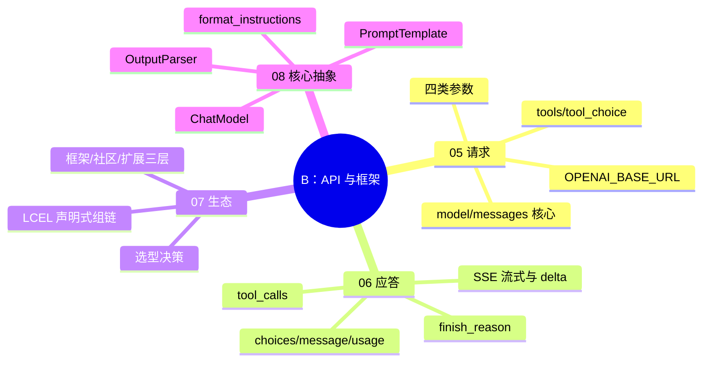

> 📌 覆盖 05–08。通过标准：✅ 全过且综合练习跑通 → 进阶段 C；⚠️ 有未过 → 回看对应篇自检；❌ 严重卡点 → 重做 08 的组链练习并写 200 字卡点记录。
> ⚠️ 环境前提：可用的 OpenAI 兼容 API（Key + Base URL）。变量名两套体系见 05/08 篇警告块。

## 阶段 B 知识图谱

## 自测清单

- [ ] 能用 curl 或 SDK 调通 /v1/chat/completions（续行符、环境变量正确）
- [ ] 能说出 temperature / max_completion_tokens / stream 的作用并各做一次对比实验
- [ ] 能读懂应答 JSON：id / choices / message / usage / finish_reason 各是什么
- [ ] 能解释流式 delta 与常规 message 的区别，SSE 为何被选中而非 WebSocket
- [ ] 能写出带 tools + tool_choice 的请求，解释 auto/required/none 的行为
- [ ] 能说出 LangChain 三层生态，并用 LCEL 组装 prompt | model | parser
- [ ] 能分别接 StrOutputParser 与 JsonOutputParser，打印 format_instructions 看格式约束
- [ ] 能分清 OPENAI_BASE_URL（原生 SDK）与 OPENAI_API_BASE（langchain_openai）两套变量名

## 综合练习：结构化翻译链

用 08 篇的抽象组装一条链，要求：

1. 输入一段英文，输出 JSON：`{"translation": "...", "word_count": N}`（用 pydantic + JsonOutputParser）；
2. 系统提示词约束「只输出 JSON，不要解释」；
3. 同一输入分别跑 invoke 与 stream，记录首字延迟差异；
4. 故意传入非法 JSON 场景（如让模型输出散文），观察 parser 报错形态，写一行结论。

**怎样算过**：① 合法输入下解析出含 translation / word_count 两键的 JSON；② stream 首字延迟小于 invoke 全程耗时；③ 非法场景能捕获到解析异常（如 OutputParserException）而非静默吞掉——预期就是报错，能说出报错类型与触发条件即过。

## 自测选择题（5 题）

**1. 请求带了 tools 且 tool_choice="required"，应答报文会是什么样？**
- A. content 正常返回文本，tool_calls 为空
- B. finish_reason=tool_calls，content 为 null，message.tool_calls 里给出函数名与参数
- C. 服务端报错，required 不是合法取值
- D. 返回 usage=0

答案与解析

**答案：B**。05 篇 tool_choice 四取值（none/auto/required/指定函数）+ 06 篇报文实例：required 强制模型必须发起工具调用，内容在 message.tool_calls，content 为 null。

**2. 流式应答中每个消息块的内容放在？**
- A. choices[].message
- B. choices[].delta
- C. data.content
- D. usage.completion

答案与解析

**答案：B**。06 篇：chunk 的内容在 choices[].delta；常规应答才在 message。

**3. 一次流式应答里，各消息块的 id 与 object 是？**
- A. 每块 id 不同，object=chat.completion
- B. 所有块 id 相同，object=chat.completion.chunk
- C. id 相同，object=chat.completion
- D. 没有 id 字段

答案与解析

**答案：B**。06 篇细节段：同一次应答的所有块共用一个 id（保证属于同一消息），类型为 chat.completion.chunk。

**4. 原生 openai SDK（1.x）读取的 Base URL 环境变量是？**
- A. OPENAI_API_BASE
- B. OPENAI_BASE_URL
- C. API_BASE
- D. OPENAI_URL

答案与解析

**答案：B**。J5 裁决：原生 SDK 用 OPENAI_BASE_URL；OPENAI_API_BASE 是 langchain_openai 的变量名，两套体系勿混（05/08 篇警告块）。

**5. JsonOutputParser 的格式约束是怎么进入提示词的？**
- A. 模型自动知道
- B. get_format_instructions() 生成指令，经 partial_variables 注入模板
- C. 写在 system 消息外
- D. API 参数 response_format 自动加

答案与解析

**答案：B**。08 篇：parser.get_format_instructions() 生成格式说明，通过 partial_variables 预填进 PromptTemplate；不是 API 层的 response_format。

## 分级反馈表

| 你的情况 | 建议 |
|----------|------|
| ✅ 清单全过 + 练习跑通 | ✅ 进入阶段 C（[[01-学习/程序员的AI开发第一课/99-阶段C检查点-应用开发|99-阶段C检查点]]） |
| API 调不通 | 先查 05 篇 curl 警告块（续行符/变量名），再查网络与 Key |
| 组链报错 | 回看 [[01-学习/程序员的AI开发第一课/08｜LangChain：核心抽象|08]] 三个抽象的分工 |
| 选择题错 3+ 题 | 重读 05/06，重做综合练习 |

## 相关笔记

- ⬅️ 本阶段：05–08 ｜ 上一检查点：[[01-学习/程序员的AI开发第一课/99-阶段A检查点-概念与提示|99-阶段A检查点]]
- ➡️ 下一阶段：[[01-学习/程序员的AI开发第一课/99-阶段C检查点-应用开发|99-阶段C检查点-应用开发]]
- 🔗 概念对照：[[01-学习/程序员的AI开发第一课/99-概念对照总表|99-概念对照总表]]
- 🔗 总览：[[01-学习/程序员的AI开发第一课/总览索引|总览索引]]

---
*创建：2026-11-13 · 课程化批（P1-11）*