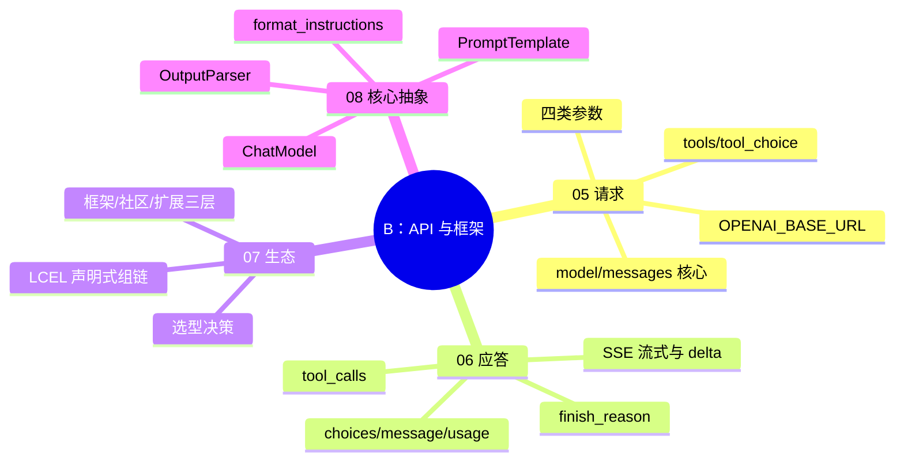

> 📌 覆盖 05–08。通过标准：🟢 全过且综合练习跑通 → 进阶段 C；🟡 有未过 → 回看对应篇自检；🔴 未过 → 重做 08 的组链练习并写 200 字卡点记录。
> ⚠️ 环境前提：可用的 OpenAI 兼容 API（Key + Base URL）。变量名两套体系见 05/08 篇警告块。

## 阶段 B 知识图谱

## 自测清单

- [ ] 能用 curl 或 SDK 调通 /v1/chat/completions（续行符、环境变量正确）
- [ ] 能说出 temperature / max_completion_tokens / stream 的作用并各做一次对比实验
- [ ] 能读懂应答 JSON：id / choices / message / usage / finish_reason 各是什么
- [ ] 能解释流式 delta 与常规 message 的区别，SSE 为何被选中而非 WebSocket
- [ ] 能写出带 tools + tool_choice 的请求，解释 auto/required/none 的行为
- [ ] 能说出 LangChain 三层生态，并用 LCEL 组装 prompt | model | parser
- [ ] 能分别接 StrOutputParser 与 JsonOutputParser，打印 format_instructions 看格式约束
- [ ] 能分清 OPENAI_BASE_URL（原生 SDK）与 OPENAI_API_BASE（langchain_openai）两套变量名

## 综合练习：结构化翻译链

用 08 篇的抽象组装一条链，要求：

1. 输入一段英文，输出 JSON：`{"translation": "...", "word_count": N}`（用 pydantic + JsonOutputParser）；
2. 系统提示词约束「只输出 JSON，不要解释」；
3. 同一输入分别跑 invoke 与 stream，记录首字延迟差异；
4. 故意传入非法 JSON 场景（如让模型输出散文），观察 parser 报错形态，写一行结论。

## 自测选择题（5 题）

**1. finish_reason 为 tool_calls 时，内容在哪个字段？**
- A. message.content
- B. message.tool_calls ✅
- C. choices.delta
- D. usage

**2. 流式应答中每个消息块的内容放在？**
- A. choices[].message
- B. choices[].delta ✅
- C. data.content
- D. usage.completion

**3. `chain = prompt | model | parser` 的执行顺序是？**
- A. parser → model → prompt
- B. 声明顺序：prompt → model → parser ✅
- C. 并行执行
- D. 随机

**4. 原生 openai SDK（1.x）读取的 Base URL 环境变量是？**
- A. OPENAI_API_BASE
- B. OPENAI_BASE_URL ✅
- C. API_BASE
- D. OPENAI_URL

**5. JsonOutputParser 的格式约束是怎么进入提示词的？**
- A. 模型自动知道
- B. get_format_instructions() 生成指令，经 partial_variables 注入模板 ✅
- C. 写在 system 消息外
- D. API 参数 response_format 自动加

## 分级反馈表

| 你的情况 | 建议 |
|----------|------|
| 🟢 清单全过 + 练习跑通 | ✅ 进入阶段 C（[[01-学习/程序员的AI开发第一课/99-阶段C检查点-应用开发|99-阶段C检查点]]） |
| API 调不通 | 先查 05 篇 curl 警告块（续行符/变量名），再查网络与 Key |
| 组链报错 | 回看 [[01-学习/程序员的AI开发第一课/08｜LangChain：核心抽象|08]] 三个抽象的分工 |
| 选择题错 3+ 题 | 重读 05/06，重做综合练习 |

## 相关笔记

- ⬅️ 本阶段：05–08 ｜ 上一检查点：[[01-学习/程序员的AI开发第一课/99-阶段A检查点-概念与提示|99-阶段A检查点]]
- ➡️ 下一阶段：[[01-学习/程序员的AI开发第一课/99-阶段C检查点-应用开发|99-阶段C检查点-应用开发]]
- 🔗 总览：[[01-学习/程序员的AI开发第一课/总览索引|总览索引]]

---
*创建：2026-11-13 · 课程化批（P1-11）*