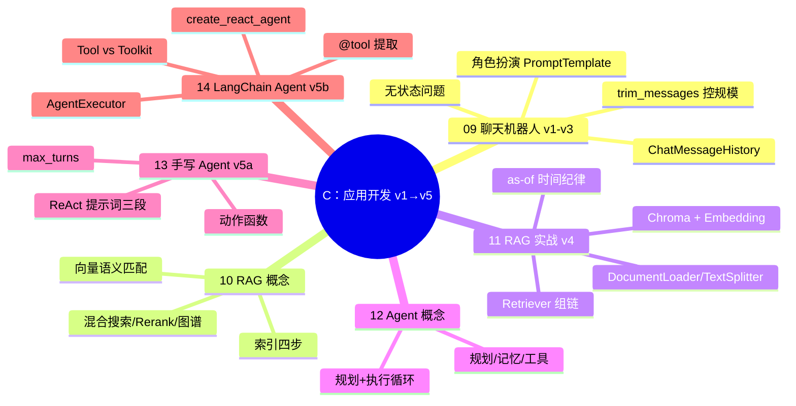

> 📌 覆盖 09–14，对应毕业项目 **v1→v5**（v1–v4 累积演进；v5 为并列的单点能力演示，不含 v2–v4 的记忆/角色/RAG，叙事口径见总览 J8）。通过标准：✅ 全过且 v4/v5 验收问题通过 → 进阶段 D；⚠️ 有未过 → 回看对应篇自检；❌ 严重卡点 → 回到本阶段首个动手篇（09）重做并写 200 字卡点记录。
> ⚠️ 安全前提：13/14 篇的 eval 与 ShellTool 有警告块，实验在隔离环境跑。

## 阶段 C 知识图谱

## 自测清单（按项目版本验收）

- [ ] **v1**：跑通最简聊天，复现「问我是谁答不出」
- [ ] **v2**：报过名字后能答「我是谁」（session_id 隔离两个会话互不串）
- [ ] **v3**：角色风格符合设定；长对话触发 trim 后系统角色提示仍在
- [ ] **v4**：库内问题答对、库外问题敢说不知道；能说出 similarity 与 MMR 差异
- [ ] **v5**：水果价格题（3kg 苹果 + 2kg 香蕉）在 max_turns 内收敛，**正确结果 = 42**；若得到 22，是模型把题意改成了 1kg（见 13 篇勘误块）——这恰是本版要学的：验收必须核对结果与题意一致，不能只看「跑通了」；手写版（v5a）与 LangChain 版（v5b）都跑通
- [ ] 能解释 `itemgetter | retriever` 靠 `__ror__` 组链、`RunnablePassthrough.assign` 注入 context
- [ ] 能给手写 Agent 新增一个动作并同步进提示词
- [ ] 能说出 @tool 提取了函数的哪三样东西（名/参数/Docstring）
- [ ] 能解释 Agent 为什么是「循环」而不是「链」，成本失控点在哪
- [ ] 能说出 eval / ShellTool 的三层防护（隔离/白名单/人工确认）

## 综合练习：给 v4 换业务语料

把 11 篇的开篇词语料换成你自己的资料（如项目 README、一份产品文档）：

1. 重新索引，验证 3 个库内问题答对；
2. 问 1 个库外问题，确认模型说不知道（提示词约束生效）；
3. 调 chunk_size（如 500/1000/2000）各跑一遍，记录检索质量差异；
4. 若语料带日期：写出「检索前按 publish_date <= as_of 裁剪」的伪代码（量化视角，见 11 篇警告块）。

**怎样算过**：① 3 个库内问题全部答对且答案出自你的语料（不是模型常识）；② 库外问题明确说不知道，不编造；③ 三档 chunk_size 各留下一条检索质量记录（命中片段是否完整、是否混入噪声），并能说出你会选哪一档及理由；④ 带日期语料能写出 as-of 裁剪伪代码。四项全占才算过。

## 自测选择题（5 题）

**1. 聊天机器人「记不住上下文」的根本原因是？**
- A. 模型太笨
- B. HTTP API 无状态，服务端不保留会话
- C. temperature 太高
- D. Token 不够

答案与解析

**答案：B**。09 篇：HTTP 请求无状态，会话记忆要靠客户端把历史传回去（ChatMessageHistory）。

**2. trim_messages 的 include_system=True 是为了？**
- A. 加快生成
- B. 截断历史时保留最前面的系统角色设定
- C. 减少计费
- D. 支持多用户

答案与解析

**答案：B**。参数语义如此；但注意链序——v3 是 `trimmer | prompt | model`，trimmer 在 prompt 之前拿不到系统消息，该参数在此链序下不起作用（角色设定不丢是因为 prompt 每轮重建）；到 11 篇 `prompt | trimmer` 链序才真正参与判定，见 09 篇「链序说明」注记。

**3. 把 chunk_size 从 1000 调小到 200，对检索的影响说法正确的是？**
- A. 一定提升质量，块越小越精确
- B. 块更碎可能切断关键句、命中片段缺上下文；块太大则混入噪声——需按语料实测权衡
- C. chunk_size 只影响存储不影响检索
- D. chunk_overlap 会随之自动失效

答案与解析

**答案：B**。11 篇：RecursiveCharacterTextSplitter 按分隔符递归拆分，chunk_size/chunk_overlap 共同决定块的完整性与重叠度；本检查点综合练习第 3 步的三档对比就是验收方式。

**4. similarity 与 MMR（max_marginal_relevance_search）检索的差别是？**
- A. MMR 更快
- B. similarity 只按相似度排序；MMR 在相关性之外尽量选与已选结果不相似的文档，增加多样性
- C. MMR 不需要 Embedding
- D. 二者完全等价

答案与解析

**答案：B**。11 篇：MMR（最大边际相关性）在保持相关性的同时惩罚与已选结果的相似，适合去重/多样化场景；v4 的 as_retriever(search_type=...) 可切换。

**5. 13 篇示例中提问 3kg 苹果却算出 22，说明了什么？**
- A. 计算器坏了
- B. 工具算对了但模型中间推理改错了题意——验收要校验结果与题意一致
- C. 提示词写错了必须改原文
- D. 香蕉价格变了

答案与解析

**答案：B**。13 篇勘误块：模型把 3kg 自行改成 1kg，`1*10+2*6=22`；正确应为 `3*10+2*6=42`（14 篇同题输出 42）。工具计算正确 ≠ 最终答案正确。

## 分级反馈表

| 你的情况 | 建议 |
|----------|------|
| ✅ 清单全过 + v4/v5 验收通过 | ✅ 进入阶段 D（[[01-学习/程序员的AI开发第一课/99-阶段D检查点-工程与模型|99-阶段D检查点]]） |
| v2/v3 卡住 | 回看 [[01-学习/程序员的AI开发第一课/09｜从零实现一个角色扮演的聊天机器人|09]]，重点 input_messages_key 与 MessagesPlaceholder |
| v4 检索不准 | 回看 [[01-学习/程序员的AI开发第一课/11｜自己动手实现一个RAG应用|11]]，先调 chunk 再换 Embedding |
| v5 不收敛 | 回看 [[01-学习/程序员的AI开发第一课/13｜从头实现一个Agent|13]] 提示词三段结构，检查动作名与提示词是否一致 |

## 相关笔记

- ⬅️ 本阶段：09–14 ｜ 上一检查点：[[01-学习/程序员的AI开发第一课/99-阶段B检查点-API与框架|99-阶段B检查点]]
- ➡️ 下一阶段：[[01-学习/程序员的AI开发第一课/99-阶段D检查点-工程与模型|99-阶段D检查点-工程与模型]]
- 🔗 概念对照：[[01-学习/程序员的AI开发第一课/99-概念对照总表|99-概念对照总表]]
- 🔗 项目线：[[01-学习/程序员的AI开发第一课/总览索引|总览索引]] v1→v7 梯表 · 代码入口 [[01-学习/程序员的AI开发第一课/code/ai-app/README|code/ai-app]]

---
*创建：2026-11-13 · 课程化批（P1-11）*