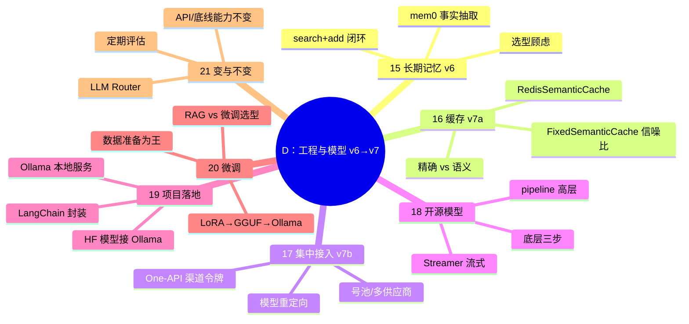

> 📌 覆盖 15–21 + 结束语/加餐，对应毕业项目 **v6→v7** 与结课判定。v6/v7 为并列的单点能力演示（v6 以 09 篇角色机器人为底座、不含 v5 Agent；v7 只演示缓存与网关两件事，叙事口径见总览 J8）。通过标准：✅ 全过且 v6/v7 验收通过 → 结课（做下方结课综合题）；⚠️ 有未过 → 回看对应篇自检；❌ 严重卡点 → 回 15 篇重做并写 200 字卡点记录。加餐两篇不参与版本验收，只作扩展阅读。
> ⚠️ 环境前提：v6 需可用 API + `mem0ai`；v7a 需 Redis Stack（Docker）+ redis-py，v7b 需 One-API（Docker）；18 篇 CPU 即可跑 Qwen2.5-0.5B，19 篇需本地 Ollama。受限环境替代路径见 [[01-学习/程序员的AI开发第一课/code/ai-app/README|code/ai-app/README]]「受限环境怎么跑」。
> ⚠️ 20 篇微调需 GPU/conda 环境（+4–6h 另计）；无 GPU 可先完成 🟢 与选型对比，微调实操标 ⏸️ 待环境。

## 阶段 D 知识图谱

## 自测清单（按项目版本验收）

- [ ] **v6**：重启进程后机器人仍记得用户偏好（mem0 search+add 闭环）
- [ ] **v7a**：两句同义提示词第二次命中缓存（以 usage=0 或 lookup 返回非 None 为准，提速只作辅助证据），能解释 prompt_key 的作用
- [ ] **v7b**：应用切到 One-API 后业务代码零改动；配置一条模型重定向并验证
- [ ] 能用 pipeline 在 CPU 上跑通 Qwen2.5-0.5B，并用底层三步复现
- [ ] 能解释 TextIteratorStreamer 为什么要配 Thread
- [ ] 能在 One-API 加 Ollama 渠道，用 OpenAI SDK 调本地模型
- [ ] 能说出 RAG vs 微调的选型判据（更新频率/格式固定度/数据质量）与二者结合的用法
- [ ] （有 GPU）完成一次 LLaMA Factory 小微调 → GGUF → Ollama 全链
- [ ] 能设计一版 LLM Router 路由规则（简单推理本地 / 复杂生成云端）
- [ ] 能用费曼学习法把全课程主线讲一遍，标出仍讲不清的缺口

## 结课综合题（三选二，每题 ≥200 字）

1. **选型题**：你的业务要做一个「研报问答助手」，语料每天更新。给出 RAG / 微调 / 改提示词的选型结论、理由与反悔条件（提示：as-of 纪律、数据新鲜度、格式固定度）。
2. **架构题**：画出你的 v7 完整架构（应用 → 缓存 → 网关 → 模型），标出每一层解决什么问题、哪层可以省掉。
3. **演进题**：选一个 2026 年新发布的模型（近期无新发布时，改评你正在用的模型），按 21 篇的「场景/性能/成本」清单做一次替换评估，给出结论。

**评分维度**（每题 ≥200 字之外，按四项自判）：① 结论明确（选了什么/不选什么）；② 判据落到课程概念（如 as-of 纪律、数据新鲜度、格式固定度、成本口径）；③ 给出反悔条件（什么情况下推翻结论）；④ 无凭空事实（数字/版本有来源或标注待核）。四项全占才算过。

## 自测选择题（5 题）

**1. mem0 的 add 实际存入向量库的是？**
- A. 聊天原文
- B. 大模型从内容中抽取的事实
- C. 向量化的整段对话
- D. 用户 ID

答案与解析

**答案：B**。15 篇：add 先把内容发给大模型抽取事实，真正存放的是事实而非原文；这也是 v6「重启仍记得偏好」的基础。

**2. 用底层方式复现 pipeline("text-generation") 的正确三步顺序是？**
- A. 解码→生成→分词
- B. tokenizer 编码→model.generate 生成→tokenizer 解码
- C. Embedding→检索→拼接
- D. 下载→微调→量化

答案与解析

**答案：B**。18 篇：pipeline 高层封装内部就是「分词编码 → 模型生成 → 解码回文本」三步；底层复现是 🟡 自检项。C 是 RAG 的流程，不是生成三步。

**3. TextIteratorStreamer 为什么要配 Thread 使用？**
- A. 提升模型精度
- B. model.generate 会阻塞当前线程；把生成放进子线程，主线程迭代 streamer 逐块输出，才能边生成边打印
- C. 节省显存
- D. 绕过 Python GIL 加速计算

答案与解析

**答案：B**。18 篇：同线程里 generate 不返回就拿不到输出，流式体验无从谈起；子线程生成 + 主线程消费迭代器实现异步流式（与 06 篇 SSE 的服务端推送同构，只是发生在本地）。

**4. One-API 容器连宿主机 MySQL，DSN 里不能写？**
- A. host.docker.internal
- B. 容器内 localhost（指向容器自身）
- C. compose 服务名
- D. --network host 下的 127.0.0.1

答案与解析

**答案：B**。17 篇警告块：容器内 localhost 指向容器自身；三种可行写法见 A/C/D。不配 SQL_DSN 时落 SQLite，可据此判断连没连上 MySQL。

**5. LLM Router 与大模型代理（One-API）的区别是？**
- A. 没有区别
- B. 代理需调用方指定模型；路由按用途内部决定模型，调用方可不指定
- C. 路由只能本地模型
- D. 代理更贵

答案与解析

**答案：B**。21 篇 + 17 篇：代理只提供标准 OpenAI API，调用时指定模型；Router 把「用途→模型」的选型配置在内部，隔离应用与模型变化。

## 分级反馈表

| 你的情况 | 建议 |
|----------|------|
| ✅ 清单全过 + 综合题完成 2 题 | 🎓 结课。对照 code/ai-app/README 逐版实跑并标记已通过的版本，写结课复盘 |
| v6 记不住 | 回看 [[01-学习/程序员的AI开发第一课/15｜长期记忆：让大模型更了解你|15]]，确认 search 在调用前、add 在调用后 |
| v7 缓存不命中 | 回看 [[01-学习/程序员的AI开发第一课/16｜缓存：节省使用大模型的成本|16]] FixedSemanticCache 与 Redis Stack 前提 |
| 微调环境卡住 | 标 ⏸️ 不阻塞结课；先完成选型对比，环境就绪再补实操 |

## 相关笔记

- ⬅️ 本阶段：15–21 + 结束语/加餐 ｜ 上一检查点：[[01-学习/程序员的AI开发第一课/99-阶段C检查点-应用开发|99-阶段C检查点]]
- 🔗 概念对照：[[01-学习/程序员的AI开发第一课/99-概念对照总表|99-概念对照总表]]
- 🔗 总览：[[01-学习/程序员的AI开发第一课/总览索引|总览索引]]

---
*创建：2026-11-13 · 课程化批（P1-11）*